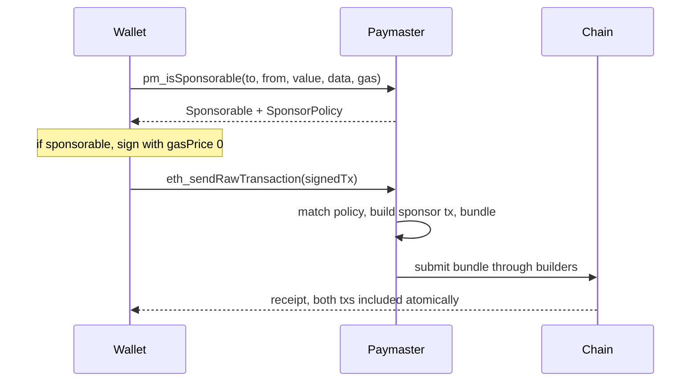

# Account Abstraction and Cross-Chain Bridge on Bitgold Network

Bitgold's **EOA-based Paymaster** is a gas sponsorship service for ordinary externally owned accounts. A wallet asks a paymaster whether a transaction is sponsorable; if the answer is yes, the wallet sets the transaction's gas price to zero, has the user sign it, and submits the signed transaction to the paymaster, which pairs it with a paying "sponsor transaction" in the same atomic bundle. The user keeps their existing key and address, the wallet changes only its send path, and no smart contract wallet or EntryPoint deployment is involved. What it is **not**: it is not EIP-4337 account abstraction, it does not create or migrate users to a smart contract account, it does not issue user operations or call `validatePaymasterUserOp`, it does not custody user funds, and it is not a guarantee of free gas. Sponsorship is granted only when the transaction matches an operator-defined sponsor policy, and the paymaster is run by third parties, not by the protocol.

## Concepts

The terms below are the documentation's own. Bitgold is forked from the BSC v1.8.1 codebase, so it inherits a proposer-builder separation (PBS) block pipeline in which validators no longer check per-transaction gas prices inside a block. That is what makes a zero-gas-price transaction includable at all: builders package bundles into block proposals, and proposers select the most profitable proposal.

| Concept | Meaning as documented |
| --- | --- |
| Paymaster | "An infrastructure component that enables transaction sponsorship, allowing self or third parties to cover gas fees." |
| Sponsor | The self- or third-party account covering the gas. After inclusion, "the Paymaster Manager updates the sponsor's account, deducting the appropriate amount for the sponsored gas." |
| Sponsor Policy | "A set of rules defined by the gas sponsor to determine which transactions qualify for sponsorship ... criteria such as whitelisted transaction senders or specific transaction types." In practice: sender/recipient addresses, token types, or transaction limits. Returned to the wallet as the `SponsorPolicy` string. |
| Sponsored transaction | The user's original transaction, signed with gas price set to zero, accepted only if the policy matches. Its counterpart is the paymaster-created sponsor transaction "with a higher gas price" that pays for inclusion. |
| Bundle | "An ordered array of transactions that execute atomically, ensuring all transactions in the bundle are processed together or not at all." |
| Settlement | Post-transaction processing in which the Paymaster Manager debits the sponsor's account for the sponsored gas. |

## Paymaster API

The interface is **JSON-RPC 2.0 over HTTP POST**, not REST: a single endpoint URL receives named methods, so there is no resource path layout. The docs define exactly two methods.

| Item | Documented value |
| --- | --- |
| Transport | HTTP POST, JSON-RPC 2.0 (`jsonrpc`, `id`, `method`, `params`) |
| Base URL | **Placeholder.** No paymaster endpoint URL is published. The overview names NodeReal MegaFuel and Bitget Wallet as paymaster infrastructure; each operator publishes its own URL. |
| Authentication | **Placeholder.** No API key, auth header name, or signature scheme is documented. Any required header is operator-specific, from that operator's own docs. |

### pm_isSponsorable

| Param field | Type | Notes |
| --- | --- | --- |
| `to` | address | Recipient address of the transaction |
| `from` | address | Sender address of the transaction |
| `value` | hex string | Transaction value in hexadecimal, e.g. `0x1b4` |
| `data` | hex string | Calldata in hexadecimal, `0x` when empty |
| `gas` | hex string | Gas limit in hexadecimal, e.g. `0x101b4` |

```json
{
  "jsonrpc": "2.0", "id": 1, "method": "pm_isSponsorable",
  "params": [{ "to": "0x...", "from": "0x...", "value": "0x1b4", "data": "0x", "gas": "0x101b4" }]
}
```

```json
{
  "jsonrpc": "2.0", "id": 1,
  "result": { "Sponsorable": true, "SponsorPolicy": "a sample policy name" }
}
```

Both response fields are required and capitalised exactly as documented: `Sponsorable` (boolean, whether the transaction is sponsorable) and `SponsorPolicy` (string, the name of the matched sponsor policy).

Two documentation defects matter before you code against this. The published request example repeats the `value` key; send it once. And the wallet-integration page calls the method `gm_sponsorable` while the API spec defines `pm_isSponsorable`. The API spec is the normative name, so make the method name configurable per operator rather than hardcoding either spelling.

### eth_sendRawTransaction

Follows the standard Ethereum JSON-RPC spec: `params` is a one-element array holding the signed transaction as a hex string, and the result is the 32-byte transaction hash.

```json
{
  "jsonrpc": "2.0", "id": 1, "method": "eth_sendRawTransaction",
  "params": ["0x<signed-transaction-hex>"]
}
```

Sign the transaction with the wallet's own key, with `gasPrice` set to `0x0` for the sponsored leg. Do not copy a raw transaction out of a tutorial: the envelope encodes the chain id, and a string signed for another chain is rejected (or worse, replayed nowhere useful). The supported shape on Bitgold is a legacy type-0 transaction with an explicit `gasPrice` - `baseFeePerGas` is `0x0`, so the sponsored leg carries zero and the paired sponsor transaction carries the real price (around 5 gwei at the time of writing, read it from `eth_gasPrice`).

### Errors, quoting, and status

| Topic | Status in the docs |
| --- | --- |
| Error codes | **Placeholder.** No paymaster error-code table is published. Handle generic JSON-RPC errors: an `error` object with `code`, `message`, and optional `data`. |
| Quote / estimate | **Placeholder.** No quote or fee-estimate method exists. Sponsorship cost is not quoted to the caller; the sponsor is debited at settlement. |
| Status | **Placeholder for paymaster-specific status.** The docs say only to "monitor the transaction status as usual"; there is no `pm_*` status method. With the hash in hand, poll standard `eth_getTransactionReceipt` on a Bitgold RPC endpoint. |

### curl: the main flow

Step 1, ask whether the transaction is sponsorable:

```bash
curl -sS -X POST "$BITGOLD_PAYMASTER_URL" -H 'content-type: application/json' \
  --data '{"jsonrpc":"2.0","id":1,"method":"pm_isSponsorable","params":[{"to":"0xRecipient","from":"0xSender","value":"0x0","data":"0xa9059cbb0000000000000000000000000000000000000000000000000000000000000000","gas":"0x101b4"}]}'
```

Step 2, sign locally with gas price zero and submit the raw bytes to the paymaster:

```bash
curl -sS -X POST "$BITGOLD_PAYMASTER_URL" -H 'content-type: application/json' \
  --data '{"jsonrpc":"2.0","id":2,"method":"eth_sendRawTransaction","params":["0xSignedZeroGasPriceTx"]}'
```

Step 3, poll for the receipt on the network RPC using the returned hash (a standard EVM method, not a paymaster method):

```bash
curl -sS -X POST "$BITGOLD_RPC_URL" -H 'content-type: application/json' \
  --data '{"jsonrpc":"2.0","id":3,"method":"eth_getTransactionReceipt","params":["0xReturnedTxHash"]}'
```

## Wallet integration

The documented client flow, in order:

1. **Transaction preparation.** On user-initiated transactions, call the sponsorability method first. Only if sponsorable, set the transaction's gas price to zero.
2. **User notification.** Tell the user the transaction is gas-free, naming the sponsor via the returned `SponsorPolicy` string.
3. **Transaction signing.** Have the user sign the zero-gas-price transaction.
4. **Submission to the paymaster.** Send the signed transaction with `eth_sendRawTransaction`.
5. **Response handling.** On success, report submission to the user. On failure, fall back to normal processing or report the failure.
6. **Transaction monitoring.** Monitor status as usual.



A client built strictly from the documented payload shapes, using `fetch` for paymaster calls and viem for signing and receipt polling. URLs come from configuration because no public URL or auth header is documented:

```typescript
import { createPublicClient, http, type Hex } from 'viem'
import { privateKeyToAccount } from 'viem/accounts'

// Placeholders: the paymaster operator publishes its URL and any auth header.
const PAYMASTER_URL = process.env.BITGOLD_PAYMASTER_URL!
const RPC_URL = process.env.BITGOLD_RPC_URL!
const CHAIN_ID = 618 // 617 on testnet
const account = privateKeyToAccount(process.env.PRIVATE_KEY as Hex)
const publicClient = createPublicClient({ transport: http(RPC_URL) })

async function rpc(url: string, method: string, params: unknown[]) {
  const res = await fetch(url, { method: 'POST', headers: { 'content-type': 'application/json' },
    body: JSON.stringify({ jsonrpc: '2.0', id: 1, method, params }) })
  const json = await res.json()
  if (json.error) throw new Error(`${method}: ${json.error.code} ${json.error.message}`)
  return json.result as unknown
}

async function send(to: Hex, data: Hex, value: bigint): Promise<Hex> {
  const gas = 66_000n
  const nonce = await publicClient.getTransactionCount({ address: account.address })
  const base = { to, data, value, gas, chainId: CHAIN_ID, nonce, type: 'legacy' } as const

  // 1. Detect sponsorship before touching the gas price.
  const s = (await rpc(PAYMASTER_URL, 'pm_isSponsorable', [
    { to, from: account.address, value: `0x${value.toString(16)}`, data, gas: `0x${gas.toString(16)}` },
  ])) as { Sponsorable: boolean; SponsorPolicy: string }

  // Fallback when denied: user-paid gas, still a legacy type-0 transaction.
  if (!s.Sponsorable) console.warn('not sponsored, user pays gas')
  const gasPrice = s.Sponsorable ? 0n : await publicClient.getGasPrice()

  // 2-4. Sign (gas price zero when sponsored) and submit to the paymaster.
  const signed = await account.signTransaction({ ...base, gasPrice })
  return rpc(PAYMASTER_URL, 'eth_sendRawTransaction', [signed]) as Promise<Hex>
}
```

Documented best practices: always check sponsorability before modifying the gas price; give clear user feedback about sponsorship status; implement proper error handling for sponsorship failure; and provide a fallback for non-sponsored transactions.

## Reference wallet demo

The "Try Gasless Transaction" page is a walkthrough of paymaster-integrated wallets, not a runnable sample project. There are **no commands** to run: no install step, no CLI, no repository. It documents this user flow verbatim:

```text
1. Open a wallet that supports Bitgold paymaster sponsorship.
2. Make sure the wallet is connected to Bitgold Network.
3. Start a transfer. If the transaction is eligible, the wallet shows a sponsored (zero gas) fee.
4. Confirm the transaction and check the result on www.bitgold.live.
```

The demo illustrates the behaviour with a stablecoin transfer: integrated wallets detect eligibility automatically and set the gas price to zero without user intervention. Its closing note is the operational rule: sponsorship eligibility is decided by the paymaster policy, and if a transaction is not sponsored the wallet falls back to paying gas in BTG. The docs name Bitget Wallet as an integrated wallet and NodeReal MegaFuel as a paymaster implementation that sponsors can configure.

## Operational caveats

- **Rate limits.** Not published. Requests are served by third-party operators, so quotas, per-key throughput, and burst limits are set per operator and can change without notice.
- **Sponsor-only calls.** `pm_isSponsorable` and the paymaster's `eth_sendRawTransaction` are the paymaster's own surface; treat them as operator-scoped. Read-only chain queries (`eth_getTransactionReceipt`, `eth_getTransactionCount`, `eth_getGasPrice`, `eth_chainId`) go to a normal Bitgold RPC endpoint.
- **When sponsorship is denied.** The docs state the transaction "is rejected or returned to the user for normal processing." Do not broadcast the zero-gas-price transaction: it has no inclusion path unless the paymaster bundles it. Rebuild with a real `gasPrice` and send it yourself.
- **Fallback to user-paid gas.** Because `baseFeePerGas` is `0x0`, the fallback is a legacy type-0 transaction with `gasPrice` around 5 gwei and `gas` from `eth_estimateGas`; no EIP-1559 fields are needed. Check the balance first and surface a clear "insufficient BTG for gas" state.
- **Policy scope.** Whitelists may key on sender, recipient, token, or amount, so the same wallet can be sponsorable for one call and not another. Set a zero gas price only after a positive `Sponsorable` result, keep the nonce consistent across the sponsored attempt and the fallback, and do not cache a positive result across different `to`, `data`, or `value`.
- **Third-party surface.** Paymaster endpoints, policies, and limits are operated by third parties and can change at any time.

## Cross-chain bridge

Bridging is operated by third-party bridge providers and ecosystem services, not by the Bitgold protocol itself. The network is EVM-compatible, so assets move through bridges that support Bitgold.

**Supported routes and assets.** The docs do not enumerate them, deliberately: "Never assume token support: query the bridge or its contracts for the current route and asset list." Route availability is decided by the provider. The documented entry point for Bitgold tools is the app at `https://app.bitgold.network`.

**No bridge contract address is published.** Read the bridge's own documentation for its contract addresses and API, and verify token addresses on the explorer at `https://www.bitgold.live` before approving anything. Any address presented as *the* Bitgold bridge contract should be treated as unverified.

**Deposit flow (assets to Bitgold).** First confirm the bridge supports Bitgold Mainnet (chain ID 618) or Testnet (chain ID 617), verify the token contract address on the explorer, and check which chain, token, and amount the bridge supports. Then: open the bridge from official channels, select the source chain and Bitgold as destination, connect the wallet on the source chain, choose token and amount and review route and fees, approve the token if required and send, then wait for completion and confirm the balance on the explorer. Test on testnet before moving production funds.

**Withdraw flow (assets from Bitgold).** The same flow in reverse: select Bitgold as the source chain, choose the destination chain, and confirm in the wallet. Confirmation times and fees are not published as concrete numbers: "Rate limits, fees, and finality times are set by the bridge provider," so read the provider's documentation; treat any figure quoted elsewhere as stale.

**Risks.**

- *Contract risk.* You approve token allowances to bridge contracts and lock or burn assets in them. A bug or malicious implementation can lose funds regardless of Bitgold's own safety, and approval scope is your exposure.
- *Bridge operator risk.* The operator holds the counterparty position; downtime, insolvency, key compromise, or a paused or upgraded contract can delay or block withdrawals. Bridged assets are "claims issued by the bridge, not native BTG," and a listed token may be a wrapped representation with its own issuer risk.
- *Phishing risk.* Use only bridges announced through official Bitgold channels; treat unsolicited bridge links, airdrops, and "migration" sites as potential scams, and verify token addresses and approvals before signing.

## Related references

- [Network and RPC](./network-and-rpc.md): chain IDs, RPC endpoints, and the gas model (`baseFeePerGas` of `0x0`, legacy type-0 transactions).
- [Wallets and faucet](./wallets-and-faucet.md): wallet configuration and testnet funding via `https://faucet.bitgold.network`.
- [EVM development](./evm-development.md): toolchain setup, contract deployment, and standard JSON-RPC usage.

## Sources

- https://docs.bitgold.network/bitgold-network/developers/paymaster/overview/
- https://docs.bitgold.network/bitgold-network/developers/paymaster/paymaster-api/
- https://docs.bitgold.network/bitgold-network/developers/paymaster/wallet-integration/
- https://docs.bitgold.network/bitgold-network/developers/paymaster/wallet-demo/
- https://docs.bitgold.network/bitgold-network/cross-chain-bridge/
